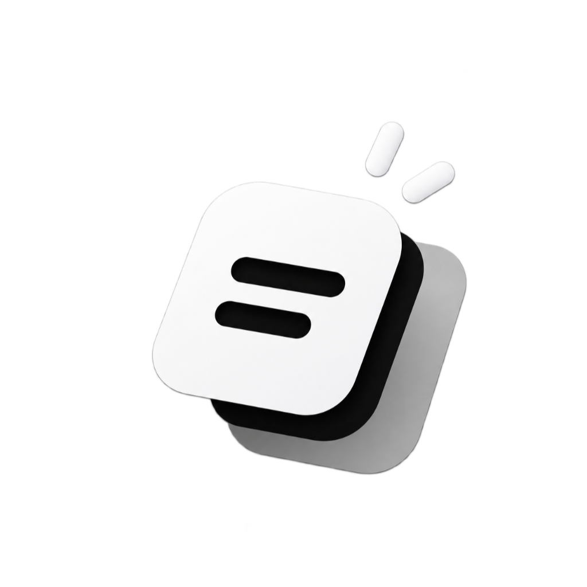
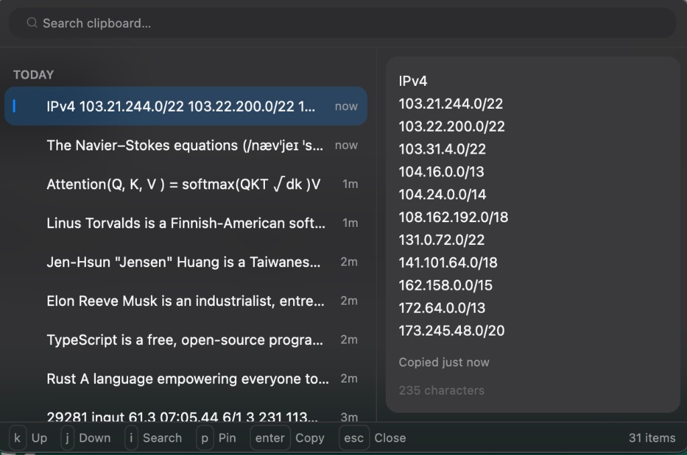
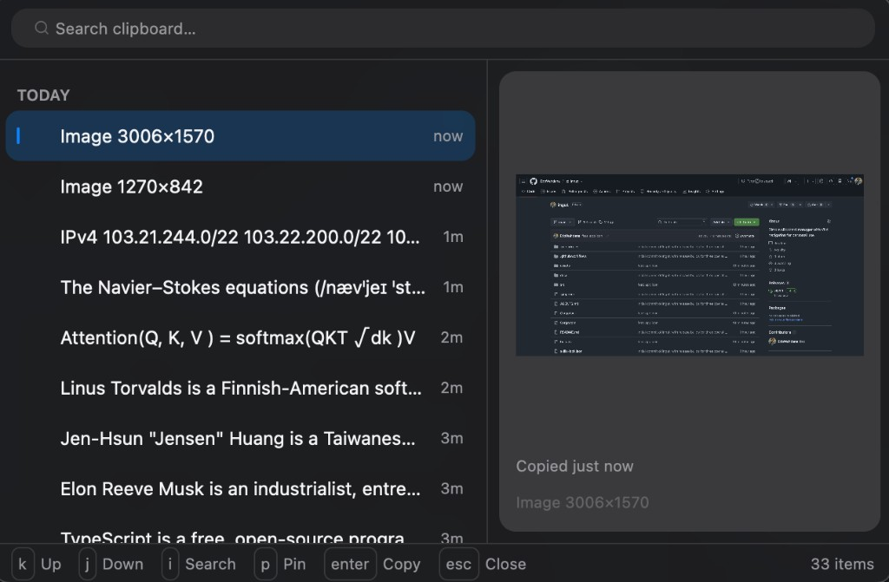

  

<h1 align="center">Ingut</h1>

  A small, keyboard-first clipboard manager for macOS, Windows, and Linux. 
  The name comes from the Indonesian word <em>ingat</em>, “to remember.”

  
  

  <a href="#features">Features</a> ·
  <a href="#keyboard">Keyboard</a> ·
  <a href="#download">Download</a> ·
  <a href="#build">Build</a>

Ingut is a native popup for clipboard history. Press the global shortcut, move with the keyboard, and copy the item you want. History stays on your machine. There is no account, no cloud sync, and no telemetry.

It is inspired by [Maccy](https://maccy.app) and written in Rust with [GPUI Kit](https://gpui-kit.com).

## Preview

  
  

## Features

- **Cross-platform clipboard manager.** The same app is built for macOS, Windows, and Linux. Open it from anywhere with the global shortcut, pick an item, and it is placed back on the clipboard.
- **Vim keys by default.** `j` and `k` move through the list. `i` focuses search. `Esc` leaves search, and `Esc` again closes the popup. `Enter` copies the selection and closes.
- **Images as well as text.** Screenshots and copied image files (PNG, JPEG, GIF, and WebP) are stored and shown in the preview. Choosing one copies the image, not just its file name.
- **Written in Rust with GPUI Kit.** The interface is a native GPU window, not a browser shell. The clipboard is checked by a change counter, so an image that is still on the clipboard is not decoded again. Full image bytes are loaded when you preview or copy that item.
- **Search.** A fuzzy filter narrows the list as you type.
- **Pins.** Press `p` to keep an item at the top. Pinned items are kept when older history is trimmed.
- **Local history.** Items are stored in a SQLite database in the application data folder. Unpinned history is capped at 200 items.
- **Follows the system theme.** The popup uses the light or dark appearance of the operating system.
- **Sits near the pointer.** The window opens beside the cursor, without a title bar, and closes when you press `Esc` or when it loses focus.

## Keyboard

The shortcut is **Command-Shift-V** on macOS and **Windows-Shift-V** on Windows.

| Key | Action |
| --- | --- |
| `j` / `↓` | Move down |
| `k` / `↑` | Move up |
| `i` | Search |
| `Esc` | Leave search, or close the popup |
| `Enter` | Copy the selected item and close |
| `p` | Pin or unpin the selected item |

## Download

Tagged versions are published on the [releases page](https://github.com/EdoWahdana/ingut/releases). Each release contains:

| File | System |
| --- | --- |
| `ingut-macos-aarch64` | macOS on Apple silicon |
| `ingut-windows-x86_64.exe` | Windows |
| `ingut-linux-x86_64` | Linux |

A push to `main` only runs the tests. A `v*` tag is what publishes a release.

## Build

The first build takes a while. GPUI Kit and its dependencies compile from source.

**macOS**

1. Install Xcode from the App Store, then point the tools at it: `sudo xcode-select -s /Applications/Xcode.app`.
2. Install Rust from [rustup](https://rustup.rs).
3. From this repository, run `cargo run`.

**Windows and Linux**

Install Rust, clone the repository, and run `cargo run`. Linux needs the system libraries listed in [`.github/workflows/build.yml`](.github/workflows/build.yml). The global shortcut is not available on Wayland yet.

## Privacy

Clipboard history never leaves the computer. Ingut does not open a network connection for sync, accounts, or usage reporting.

## License

[MIT](LICENSE)
